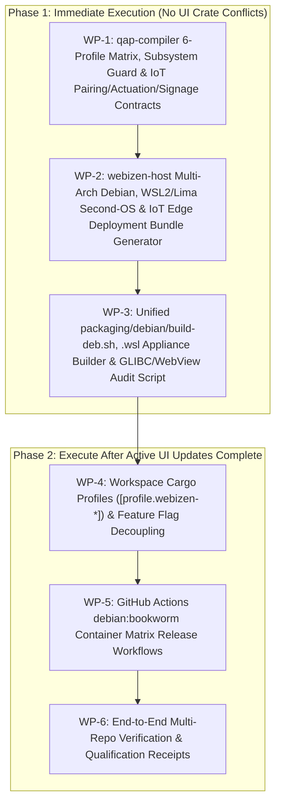

# Webizen & QualiaDB Debian Native Release & Profile Architecture Plan
## Host, Desktop, Second-OS Subsystem (WSL2 / Lima), Mobile, and IoT / Robotics / Digital-Signage Edge Environments
### Complete Implementation Specification & Grok Handover Guide

**Document ID:** `PLAN-WEBIZEN-DEBIAN-NATIVE-PROFILES-2026-11-26`  
**Status:** Authoritative Implementation Handover for Grok (Staged to execute non-UI packages immediately and UI-touching packages after active UI updates complete)  
**Date:** 2026-11-26, Australia/Sydney  
**Copyright (c) 2026 Timothy Charles Holborn**  
**https://www.linkedin.com/in/ubiquitous/ | timothy.holborn@gmail.com**  
**License:** Attribution-NonCommercial-NoDerivatives 4.0 International (CC BY-NC-ND 4.0)

---

## 1. Executive Summary & Architectural Motivation

Across the QualiaDB, Webizen, Aether, Etalon, Synth, and `.qap` application repositories, Linux CI/CD release workflows currently compile and package on **Ubuntu GitHub Actions runners (`ubuntu-22.04` and `ubuntu-24.04`)**, frequently pulling in legacy WebView (`libwebkit2gtk-4.1-0` / `libjavascriptcoregtk-4.1-0`) and Ubuntu-specific `t64` ABI dependencies. However, the **Webizen and QualiaDB native Linux foundation is Debian-based** (`debian:bookworm` / `debian:trixie`, Raspberry Pi OS / Debian ARM, and Debian Mobile / Mobian).

Furthermore, the Webizen ecosystem spans **six distinct native Linux execution environments**, including:
- **Second-OS / Guest Subsystem Appliances (`webizen-native-subsystem`)** for users running Webizen as an isolated second operating system on Windows 11 (WSL2 `.wsl` appliance), macOS (Lima / Apple `Virtualization.framework`), or non-Debian Linux desktops (Incus / Distrobox).
- **Small Edge / IoT Devices (`webizen-native-iot-headless` & `webizen-native-iot-display`)** such as Raspberry Pi boards, robotics controllers, home-automation nodes, and retail/shop digital-signage displays that must operate under **local human-centric authority** paired with a steward's local `webizen-desktop`, `webizen-subsystem`, or `webizen-host`—completely independent of major vendor cloud platforms, proprietary smart-home silos, or speculative foreign crypto rails.

### 1.1 Non-Negotiable Ecosystem & Licensing Invariants
1. **Strict Human-Rights Vocabulary:** Never use the prohibited terms `"sovereign"` or `"self-sovereign"`. Always use **human rights**, **human dignity**, **human agency**, **natural person**, **moral and material interests of the author (UDHR Art. 27(2) / ICESCR Art. 15(1)(c))**, **Sanctuary Keep / selfhood**, **Personal & Family Stewardship**, **Cooperative Quorum Stewardship**, and **Permissive Commons**.
2. **SHACL-First Non-Thing Rule:** Natural persons (`NaturalAgent`), kinship, human relations, and living ecological entities use `rdfs:Class` with W3C SHACL/ShEx and **never** subclass `owl:Thing`.
3. **Instruments Are Not Peers:** Software agents, AI models, robotics nodes, home-automation hubs, and display kiosks are **governed instruments** (`core-ontologies/agent-accountability.n3`), never independent legal entities or peer natural persons.
4. **42 MiB Prolog Sentinel & Zero-Heap Hot Paths:** Preserve the 48-byte `NQuin48` ABI, 64-byte page alignment (`QAP_ENTRY_ALIGN = 64`), `HotZeroHeap` DNS/routing/actuation gates, and 42 MiB `SlgArena` reasoning bounds.
5. **No-ASCII Policy & W3C CBOR-LD (`0xD9 0x05 0x01`):** Text manifests use UTF-8/UTF-16 (`yaml-ld-q42/v2`); binary manifests and state files use deterministic W3C CBOR-LD (`[0xD9, 0x05, 0x01]`).
6. **Live Synth MCP Safety:** Never build into `C:\github\synth\target` or `C:\github\synth\target-studio` and never kill running `synth-mcp.exe` processes. Always use an isolated `--target-dir` (e.g., `--target-dir target-debian-profiles`).

### 1.2 Execution Ordering Around Active UI Capability Updates
> **Important Sequencing Rule for Grok:**  
> Active updates are currently underway across the UI crates (`Aether`, `poet-aether-ui`, `wellfair-aether-ui`, `coop-aether-ui`). To avoid merge or file-lock conflicts:
> - **Execute Immediately (Zero UI Crate Mutation):** **WP-1** (`qap-compiler` 6-Profile Matrix, Subsystem Guard & IoT Pairing/Actuation/Signage Contracts), **WP-2** (`webizen-host` Multi-Arch Debian, WSL2/Lima Second-OS Appliance & IoT Edge Deployment Generators), and **WP-3** (Shared `packaging/debian/build-deb.sh`, `.wsl` RootFS Builder & Guard Verification Scripts).
> - **Execute After Active UI Work Completes (or in Coordinated Pass):** **WP-4** (Root `Cargo.toml` `[profile.webizen-*]` & `qualia-core-db` / `synth` / `Aether` Feature Flag Decoupling), **WP-5** (GitHub Actions `debian:bookworm` Container Matrix Workflows), and **WP-6** (Full Multi-Repo Verification & Qualification Receipts).

---

## 2. Current Ubuntu vs. Debian Mismatch Audit

| Repository & Workflow / Script | Current Linux Build Configuration | Identified Mismatch Against Debian Native Foundations |
| :--- | :--- | :--- |
| **`synth`**<br>[`.github/workflows/release.yml`](../synth/.github/workflows/release.yml)<br>[`packaging/linux/control`](../synth/packaging/linux/control) | `runs-on: ubuntu-22.04` (`x86_64` only). Installs `libwebkit2gtk-4.1-dev`, `libjavascriptcoregtk-4.1-dev`, `libgtk-3-dev`. `.deb` hardcodes `Depends: libwebkit2gtk-4.1-0, libgtk-3-0, libayatana-appindicator3-1`. | `synth/Cargo.toml` pulls `aether` with the `"desktop"` (Wry/WebView) feature alongside `aether-native`. Native Aether+Etalon builds do not need WebKit2GTK or JavaScriptCore. No `arm64` `.deb` is built. |
| **`qualiaDB`**<br>[`.github/workflows/release-cli.yml`](../qualiaDB/.github/workflows/release-cli.yml)<br>[`crates/qualia-core-db/Cargo.toml`](../qualiaDB/crates/qualia-core-db/Cargo.toml) | `runs-on: ubuntu-22.04` (`x86_64` only). Uploads raw `qualia-cli-linux-x86_64` binary without `.deb` packaging. `qualia-core-db` default features include `"gpu-native-dx12"`. | No `arm64` (`aarch64-unknown-linux-gnu`) or `armv7` (`armv7-unknown-linux-gnueabihf`) builds for Raspberry Pi / IoT or Debian ARM hosts; no headless vs. display-GPU profile separation. |
| **`Aether`**<br>[`.github/workflows/publish.yml`](../Aether/.github/workflows/publish.yml)<br>[`.github/workflows/main.yml`](../Aether/.github/workflows/main.yml) | `runs-on: ubuntu-24.04` and `ubuntu-24.04-arm`. Installs Ubuntu 24.04 `t64`-suffixed apt packages (`libasound2t64`, `libcups2t64`, `libwebkit2gtk-4.1-dev`). | Binaries compiled on `ubuntu-24.04` link against **`glibc 2.39`** and fail to start on **Debian 12 (`bookworm`, `glibc 2.36`)** with `GLIBC_2.38 / GLIBC_2.39 not found`. |
| **`qap-compiler` & `.qap` Apps** (`poet`, `wellfair`, `cooperative-projects`) | `runs-on: ubuntu-latest` (`ubuntu-24.04`). Compiles `.qap` / `.qar` packages and checks `HostEnvironmentProfile::baseline_pinned_2026_11()`. | `QapYamlLdQ42Descriptor::targets` only lists 4 generic targets (`aether-native-desktop`, `aether-native-mobile`, `webizen-host-qap`, `wasm-portal`) without Debian Second-OS Subsystem, IoT Headless, or IoT Display profiles. |
| **`webizen-host`**<br>[`vps_deployment.rs`](../webizen-host/crates/webizen-host-workbench/src/vps_deployment.rs) | Generates `Containerfile` (`FROM debian:bookworm-slim`) and `build-deb.sh` (`dpkg-deb`), plus `systemd` (`MemoryMax=512M`) and `nftables`. | Explicitly designed for Debian, but only generates an `amd64` `build-deb.sh` and lacks WSL2/Lima Second-OS appliance bundles and IoT headless/display edge deployment units. |

---

## 3. The Six Canonical Webizen Native Debian Profiles

To support the full spectrum of human-centric hardware—from VPS and home servers to workstations, **Second-OS / Subsystem appliances (WSL2 on Windows, Lima/Colima on macOS, Distrobox/Incus on Linux)**, Linux phones, headless robotics/automation nodes, and GPU-driven retail/public display appliances—we define **six canonical Webizen Native profiles**:

1. **`webizen-native-host`** — VPS, Home Server, Cooperative Hub & Namespace Lighthouse
2. **`webizen-native-desktop`** — Bare-Metal Debian Workstation, Operator Console & Poet Authoring Studio
3. **`webizen-native-subsystem`** — Second-OS / Guest Subsystem Appliance (WSL2 on Windows, Lima/VFKit on macOS, VM/Container on Linux)
4. **`webizen-native-mobile`** — Debian Mobile (Mobian / PureOS) & Handheld Companion
5. **`webizen-native-iot-headless`** — Small Devices, Robotics, Sensors & Home Automation (No GPU / No Display)
6. **`webizen-native-iot-display`** — GPU-Equipped IoT Kiosks, Shop Display Advertising & Smart Panels

### 3.1 Master Profile Comparison Matrix

| Dimension | 1. `webizen-native-host` | 2. `webizen-native-desktop` | 3. `webizen-native-subsystem` *(Second-OS / WSL2 / Lima)* | 4. `webizen-native-mobile` | 5. `webizen-native-iot-headless` | 6. `webizen-native-iot-display` |
| :--- | :--- | :--- | :--- | :--- | :--- | :--- |
| **Primary Hardware / Host Targets** | Linux VPS, Local Home Server, Sanctuary Relay (`x86_64` & `ARM64`) | Bare-Metal Debian PC, Laptop, Workstation (`x86_64` & `ARM64`) | **Windows 11 WSL2 (WSLg)**, **macOS Lima/Virtualization.framework**, **Linux KVM/Incus/Distrobox** (`x86_64` & `ARM64`) | Linux Phone / Tablet (Mobian, PinePhone Pro, Librem 5, ARM64 handhelds) | Raspberry Pi Zero 2W / 3 / 4 / 5, CM4/CM5, Robotics SBCs, Home-Automation Gateways | Raspberry Pi 4 / 5 (`V3D` Vulkan), Jetson / RK3588, Intel N100 Shop Signage / Kiosk Displays |
| **Debian Base Foundation** | `debian:bookworm-slim` (`glibc 2.36`) | `debian:bookworm` (`glibc 2.36`) | Custom **Webizen Debian RootFS** (`.wsl` / `.tar.zst` on `debian:bookworm` `glibc 2.36`) | `debian:bookworm` (`glibc 2.36`, Wayland/Phosh) | `debian:bookworm-slim` / Raspberry Pi OS Lite (`glibc 2.36` or `musl` static) | `debian:bookworm` / Raspberry Pi OS (`glibc 2.36`, KMS/DRM or Wayland Cage) |
| **Rust Target Triples (`.deb` Arch)** | `x86_64-unknown-linux-gnu` (`amd64`)<br>`aarch64-unknown-linux-gnu` (`arm64`) | `x86_64-unknown-linux-gnu` (`amd64`)<br>`aarch64-unknown-linux-gnu` (`arm64`) | `x86_64-unknown-linux-gnu` (`amd64`)<br>`aarch64-unknown-linux-gnu` (`arm64`) | `aarch64-unknown-linux-gnu` (`arm64`) | `aarch64-unknown-linux-gnu` (`arm64`)<br>`armv7-unknown-linux-gnueabihf` (`armhf`)<br>`x86_64-unknown-linux-gnu` (`amd64`) | `aarch64-unknown-linux-gnu` (`arm64`)<br>`x86_64-unknown-linux-gnu` (`amd64`) |
| **RAM & Prolog Sentinel Budget** | `>= 1 GiB` RAM (`profile_target_1024`), 42 MiB `SlgArena` Sentinel per cell | `>= 2 GiB` RAM (`profile_accelerated`), 42 MiB `SlgArena` Sentinel | `>= 1–2 GiB` bounded VM slice (`profile_accelerated`), 42 MiB `SlgArena` Sentinel | `>= 512 MiB` RAM (`profile_minimal_512`), 42 MiB `SlgArena` Sentinel | **`<= 256–512 MiB` RAM** (`profile_minimal_512`), 42 MiB `SlgArena` Sentinel, zero-heap hot loops | **`512 MiB–2 GiB` RAM** (`profile_minimal_512` / `profile_target_1024`), 42 MiB `SlgArena` Sentinel |
| **UI & Rendering Stack** | Headless daemon + Zero-JS Vibe HTTP/CBOR-LD Control Plane (**no Aether windowing, no WebView**) | `aether-native` (`vello-hybrid` / `vello` + `gpu-cpu-fallback`, `system-fonts`, `clipboard`, `accessibility`) | **Dual-Surface:**<br>1. `aether-native` via **WSLg Wayland** (`vello-hybrid` + `gpu-cpu-fallback`)<br>2. Localhost `:8080` Portal Bridge to host OS browser | `aether-native` (Wayland touch lifecycle, `vello-hybrid` + `vello-cpu-softbuffer` fallback) | **Strictly Headless** (`no` `aether-native`, `no` X11/Wayland, `no` `etalon` GPU renderer) | `aether-native` (`vello-hybrid` / `vello` over Vulkan/GLES + `gpu-cpu-fallback`, fullscreen kiosk/signage mode) |
| **GPU & Compute Stack** | Optional headless `etalon` Vulkan compute; default CPU-only (**never `gpu-native-dx12`**) | `etalon` Vulkan / GLES (`gpu-runtime`, `gpu-native-portable`, `wgsl-forge`) | `etalon` Vulkan / GLES over **Mesa `dzn` (Vulkan-on-D3D12 in WSL2)** / **VirtIO-GPU (`venus`)** + CUDA `/dev/dxg` passthrough + automatic CPU fallback | `etalon` Vulkan / GLES (`gpu-runtime`, `gpu-native-portable`) | **None** (`--no-default-features`, zero GPU drivers required) | `etalon` Vulkan / GLES (`gpu-runtime`, `gpu-native-portable`, hardware `.10d` / `.hmc` / shader presentation) |
| **Sensing, Bus & IO Crates** | `qualia-peer`, `net/dns/`, `net/qdnf/`, `qualia-solid-bridge` | `qualia-peer`, `qualia-audio`, `etalon-sense-*` (camera, mic, NFC, BLE, PCSC) | `qualia-peer` (Mirrored/NAT bridge), PulseAudio/PipeWire WSLg audio, `usbipd-win` USB/NFC/SDR passthrough, **Sanctuary ext4 VHDX isolation** | `qualia-peer`, `qualia-audio`, `etalon-sense-ble`, `etalon-sense-nfc`, `etalon-sense-camera`, `etalon-sense-wifi` | `qualia-peer`, `qualia-etalon-sensing-bridge`, `etalon-sense-*` (BLE, NFC, SDR, Wi-Fi), GPIO / I2C / SPI / UART / CAN / PWM robotics HAL | `qualia-peer`, `qualia-audio`, `qualia-etalon-sensing-bridge`, `etalon-sense-ble` / `nfc` (proximity/tap triggers), HDMI/DSI display output |
| **Debian `.deb` Runtime `Depends`** | `libc6 (>= 2.36), libssl3, ca-certificates, nftables` | `libc6 (>= 2.36), libvulkan1, libwayland-client0, libx11-6, libxkbcommon0, libfontconfig1, libasound2` | `libc6 (>= 2.36), mesa-vulkan-drivers, libvulkan1, libwayland-client0, libxkbcommon0, libfontconfig1, libpulse0, libasound2-plugins` | `libc6 (>= 2.36), libvulkan1, libgles2, libwayland-client0, libxkbcommon0, libfontconfig1, libasound2` | `libc6 (>= 2.36)` *(or zero dynamic deps on `musl`)*, optional `libudev1, libdbus-1-3` for BLE/USB/GPIO | `libc6 (>= 2.36), libvulkan1 \| libgles2, libwayland-client0 \| libdrm2, libxkbcommon0, libfontconfig1, libasound2` |

---

## 3.2 Second-OS Subsystem Architecture (`webizen-native-subsystem` — WSL2 / Lima / Incus)

Installing Webizen as a **dedicated Debian Second-OS Appliance** (`wsl --install --from-file webizen-debian.wsl --name Webizen` on Windows, or a Lima/Virtualization.framework Debian image on macOS) solves major host OS flaws:
1. **Bypasses Windows Application Control (WDAC / SmartScreen) & 2 GiB PE Linker Limits**: ELF binaries inside Debian WSL2 have no 2 GiB PE limit and execute cleanly without SmartScreen/WDAC blocks.
2. **True "Church & State" Sanctuary Keep Isolation (Protected `ext4.vhdx` vs. OneDrive/iCloud/Recall)**:
   - On Windows and macOS, user directories (`Documents`, `AppData`, `Desktop`) are frequently swept into Microsoft OneDrive, Windows Recall, or Apple iCloud sync.
   - Running inside a dedicated **`Webizen` WSL2 distribution** stores `/var/lib/qualia/sanctuary` inside an **isolated Linux `ext4.vhdx` virtual disk** (which can be LUKS-encrypted and is strictly prohibited from storing Sanctuary vaults on `/mnt/c/`, `9p`, `drvfs`, or `virtiofs` mounts).
3. **Full Linux Kernel Capabilities (`io_uring`, `nftables`, `eBPF`, `systemd`) on a Laptop**: Gives a Windows/Mac laptop the exact same Debian runtime as a production `webizen-host`.
4. **Mirrored LAN Networking for Local IoT / Raspberry Pi Pairing**: Generates a recommended `.wslconfig` (`networkingMode=mirrored`, `firewall=true`) and `/etc/wsl.conf` (`systemd=true`, `automount.enabled=false`) so the laptop's Debian subsystem can discover and pair directly with Raspberry Pi / robotics / home-automation devices on the local LAN.

---

## 4. IoT, Robotics, Home Automation & Retail Signage Architecture

> **Local Human-Centric Control Without Vendor Lock-In or Foreign Crypto:**  
> Small devices (`webizen-native-iot-headless` and `webizen-native-iot-display`) must never phone home to third-party corporate clouds (AWS IoT, Tuya, Google Home) and must never require public foreign blockchains or token gas fees to operate. Every IoT device operates as an **authenticated instrument** bound to a local **Natural Person (`NaturalAgent` `did:qi`)**, **Family/Household Guardianship group**, or **Cooperative Quorum (`M-of-N`)** via a paired `webizen-desktop`, `webizen-subsystem`, or `webizen-host` controller on the local network or private `QDNF` (`SocialWebNet` / `fd00:42::/32`) mesh.

1. **Unpaired Quarantine Boot State (`SanctuaryInstrumentUnpaired`)**:
   - When an `iot-headless` or `iot-display` package first boots on a Raspberry Pi or embedded board, it starts in `SanctuaryInstrumentUnpaired` state with **zero ambient actuation or network publication capabilities**.
2. **Local Cryptographic Pairing (`PeerHost::pair` + Post-Quantum `ML-KEM-768` + `Ed25519` + `ZCAP-LD`)**:
   - The steward pairs the device from their local **`webizen-desktop`** (`:8080`), **`webizen-subsystem`** (`:8080`), or **`webizen-host`** (`:4242`), issuing an author-scoped **`ZCAP-LD` capability delegation certificate** and a 48-byte `NQuin48` instrument enrollment receipt persisted in `<data_dir>/instrument_custody.cbor-ld`.
3. **Scoped Local Actuation & Signage Playlists (`QPolicy` + Deontic `SlgArena`)**:
   - **Robotics & Home Automation (`webizen-native-iot-headless`)**: Executes deterministic fixed-timestep control loops and `.vibe` scripts inside the 42 MiB `SlgArena` Sentinel. Every sensor read (`IoTSensing.bridge_observation`) and actuator command (`IoTActuator.command_bus` for GPIO, PWM, I2C, SPI, Modbus, CAN) requires an active `IoTInstrument.pair_with_steward_host` lease.
   - **Shop Display Advertising & Interactive Kiosks (`webizen-native-iot-display`)**: Renders QECP-signed `.hmc` / `.10d` (`HOLO` `0x0306`) signage bundles via `aether-native` + `etalon` Vulkan/GLES (with automatic `vello-cpu-softbuffer` fallback). Playlists follow the `collect != activate` invariant (`IoTSignage.present_verified_hmc`).

---

## 5. Detailed Work Packages for Grok Implementation



---

### WP-1 (Immediate): `qap-compiler` 6-Profile Matrix, Second-OS Subsystem Guard & IoT Stewardship Contracts

**Target Repository:** `C:\github\qap-compiler`  
**Files to Modify:**
1. `crates/qap-format-core/src/version_pinning_and_api_surface.rs`
2. `crates/qap-format-core/src/lib.rs`
3. `crates/qap-compiler-engine/src/lib.rs`
4. `crates/qapc-cli/src/main.rs`

#### Concrete Implementation Requirements for WP-1:
1. **`WebizenNativeProfileKind` Enum (`version_pinning_and_api_surface.rs`)**:
   - Define a canonical enum representing all 6 Debian native target environments:
     ```rust
     #[derive(Clone, Copy, Debug, PartialEq, Eq, Serialize, Deserialize)]
     pub enum WebizenNativeProfileKind {
         /// Debian VPS, Home Server, Cooperative Hub & Namespace Lighthouse (`amd64`, `arm64`)
         DebianNativeHost,
         /// Bare-Metal Debian Desktop Workstation & Poet Studio (`amd64`, `arm64`)
         DebianNativeDesktop,
         /// Second-OS Guest Subsystem Appliance: Windows WSL2 (.wsl), macOS Lima, Linux Incus (`amd64`, `arm64`)
         DebianNativeSubsystem,
         /// Debian Mobile (Mobian / PureOS / ARM64 Handhelds) (`arm64`)
         DebianNativeMobile,
         /// Headless IoT, Raspberry Pi, Robotics & Home Automation (`arm64`, `armhf`, `amd64`) — Zero GPU/GUI
         DebianNativeIotHeadless,
         /// GPU-Equipped IoT Display, Shop Signage & Interactive Kiosk (`arm64`, `amd64`) — Vulkan/GLES + CPU Fallback
         DebianNativeIotDisplay,
     }
     ```
   - Provide helper methods on `WebizenNativeProfileKind`:
     - `pub const fn slug(self) -> &'static str` returning `"webizen-native-host-debian"`, `"webizen-native-desktop-debian"`, `"webizen-native-subsystem-debian"`, `"webizen-native-mobile-debian"`, `"webizen-native-iot-headless-debian"`, `"webizen-native-iot-display-debian"`.
     - `pub const fn cargo_profile_name(self) -> &'static str` returning `"webizen-host"`, `"webizen-desktop"`, `"webizen-subsystem"`, `"webizen-mobile"`, `"webizen-iot-headless"`, `"webizen-iot-display"`.
     - `pub const fn requires_local_steward_pairing(self) -> bool` returning `true` for `DebianNativeIotHeadless` and `DebianNativeIotDisplay`.
     - `pub const fn requires_ext4_subsystem_mount_guard(self) -> bool` returning `true` for `DebianNativeSubsystem`.
     - `pub const fn max_glibc_version(self) -> &'static str` returning `"2.36"` (Debian 12 `bookworm` baseline).
     - `pub fn parse_flag(raw: &str) -> Option<Self>` accepting `"host"`, `"desktop"`, `"subsystem"` / `"wsl"`, `"mobile"`, `"iot-headless"`, `"iot-display"`.

2. **Add 5 New Capability Surface Contracts in `known_capability_surface_contract()` (`version_pinning_and_api_surface.rs`)**:
   - `"SubsystemGuard.verify_ext4_sanctuary_isolation"`:
     - Owner: `"qualiadb-core"`, Version: `"0.0.41"`, Inputs: `vec!["mount_path", "fs_type"]`, Outputs: `vec!["isolated_ext4_vhdx_ok", "host_cloud_sync_blocked", "mmap_lock_safe"]`.
     - Guidance: `"Enforces that Second-OS Subsystem (WSL2/Lima) Sanctuary Keep .q42/.q42j vaults reside on native Linux ext4 virtual disks and never on /mnt/c, 9p, drvfs, or virtiofs host mounts."`
   - `"IoTInstrument.pair_with_steward_host"`:
     - Owner: `"qualiadb-core"`, Version: `"0.0.41"`, Inputs: `vec!["steward_did_qi", "parent_host_endpoint", "zcap_delegation_token"]`, Outputs: `vec!["paired_ok", "instrument_standing", "foreign_cloud_disabled", "custody_quin_parity_ok"]`.
     - Guidance: `"Enforces local cryptographic pairing (ML-KEM-768 + Ed25519 + ZCAP-LD) between an IoT/Robotics/Signage instrument and a steward's local webizen-desktop, webizen-subsystem, or webizen-host. Instruments are never independent legal peers."`
   - `"IoTActuator.command_bus"`:
     - Owner: `"qualiadb-core"`, Version: `"0.0.41"`, Inputs: `vec!["bus_kind", "channel_id", "command_payload"]`, Outputs: `vec!["actuation_executed", "deontic_guard_receipt", "zero_heap_tick_us"]`.
     - Guidance: `"Governs local GPIO, PWM, I2C, SPI, UART, Modbus, and CAN bus actuation under 42 MiB SlgArena deontic rules after verifying active parent steward pairing."`
   - `"IoTSensing.bridge_observation"`:
     - Owner: `"etalon-gpu"`, Version: `"0.0.2"`, Inputs: `vec!["sensor_modality", "observation_envelope_digest"]`, Outputs: `vec!["measurement_quin_minted", "sidecar_custody_preserved", "consent_scope_verified"]`.
     - Guidance: `"Bridges Etalon ObservationEnvelope sensor captures (BLE, NFC, SDR, GPIO/I2C telemetry) into QualiaDB measurement records with full sidecar custody."`
   - `"IoTSignage.present_verified_hmc"`:
     - Owner: `"aether-ui"`, Version: `"0.0.41"`, Inputs: `vec!["hmc_bundle_digest", "qecp_signature", "display_mode"]`, Outputs: `vec!["playlist_activated", "renderer_backend", "cpu_fallback_ready"]`.
     - Guidance: `"Verifies QECP signature and collect != activate gate before presenting .hmc/.10d signage playlists on GPU-equipped IoT displays (with automatic vello-cpu-softbuffer fallback)."`

3. **Add Profile Constructors on `HostEnvironmentProfile` (`version_pinning_and_api_surface.rs`)**:
   - Implement `HostEnvironmentProfile::for_debian_profile(kind: WebizenNativeProfileKind) -> Self`.
   - Include the 5 new capabilities in `baseline_pinned_2026_11()` and in `for_debian_profile(...)` according to the profile's hardware role (e.g., `DebianNativeIotHeadless` excludes `WgslForge.generate` and `IoTSignage.present_verified_hmc` so a headless Raspberry Pi rejects GPU-dependent signage/shader capabilities with a clear `IncompatibleApiSurfaceChange` diagnostic if someone tries to deploy a GPU-only `.qap` to a headless board!).

4. **Update `QapYamlLdQ42Descriptor::targets` (`crates/qap-format-core/src/lib.rs`) & `qap-compiler-engine` (`crates/qap-compiler-engine/src/lib.rs`)**:
   - Include the 6 canonical Debian target strings in `QapYamlLdQ42Descriptor` default targets (`"webizen-native-host-debian"`, `"webizen-native-desktop-debian"`, `"webizen-native-subsystem-debian"`, `"webizen-native-mobile-debian"`, `"webizen-native-iot-headless-debian"`, `"webizen-native-iot-display-debian"`).
   - Add `invoke_host_capability` branches in `crates/qap-compiler-engine/src/lib.rs` for the 5 new capabilities so `.vibe` modules targeting Second-OS Subsystems or IoT devices evaluate deterministically in `qapc activate-eval`.

5. **Extend `qapc check-env` CLI (`crates/qapc-cli/src/main.rs`)**:
   - Support `qapc check-env <workspace-dir> [mode] [--profile <host|desktop|subsystem|mobile|iot-headless|iot-display>]`.
   - Add unit tests in `qap-format-core` and `qap-compiler-engine` testing all 6 Debian profiles, verifying that:
     - `SubsystemGuard.verify_ext4_sanctuary_isolation` passes on `DebianNativeSubsystem`,
     - `IoTInstrument.pair_with_steward_host` + `IoTActuator.command_bus` + `IoTSensing.bridge_observation` pass on `DebianNativeIotHeadless`,
     - Attempting to run a GPU-shader capability (`WgslForge.generate`) on `DebianNativeIotHeadless` produces an explicit, actionable `IncompatibleApiSurfaceChange` diagnostic.

---

### WP-2 (Immediate): `webizen-host` Multi-Arch Debian, WSL2/Lima Second-OS & IoT Edge Deployment Bundle Generator

**Target Repository:** `C:\github\webizen-host`  
**Files to Modify:**
1. `crates/webizen-host-workbench/src/vps_deployment.rs`
2. `crates/webizen-host-workbench/src/lib.rs` (export any new types/functions cleanly)

#### Concrete Implementation Requirements for WP-2:
1. **Multi-Arch & Multi-Profile Debian Deployment Artifacts (`vps_deployment.rs`)**:
   - Upgrade `build-deb.sh` generated in `write_linux_vps_deployment_bundle` so it accepts `ARCH="${2:-amd64}"` (`amd64`, `arm64`, `armhf`) and `PROFILE="${3:-webizen-host}"`, writing `libc6 (>= 2.36)` in `DEBIAN/control` so packages align with Debian 12 `bookworm`.
2. **Add Second-OS Subsystem & IoT Edge Bundle Generator (`write_debian_native_profile_bundles`)**:
   - In `vps_deployment.rs`, add a new struct `DebianProfileBundlePaths` and function `write_debian_native_profile_bundles(data_dir: &Path, state: &HostPersistentState) -> io::Result<DebianProfileBundlePaths>` (also called automatically or available alongside `write_linux_vps_deployment_bundle`) that writes into `<data_dir>/deploy/profiles/`:
     1. **`wsl-second-os/wsl.conf`**:
        - Configures `[boot] systemd=true`, `[automount] enabled=false`, `[network] generateResolvConf=true`, `[interop] enabled=true` to isolate the Webizen Debian Second-OS filesystem from `/mnt/c` automount leaks.
     2. **`wsl-second-os/dot-wslconfig.sample`**:
        - Recommends `[wsl2] networkingMode=mirrored`, `firewall=true`, `dnsTunneling=true`, `autoProxy=true` so the laptop's WSL2 instance can pair directly with Raspberry Pi / IoT devices on the local LAN.
     3. **`wsl-second-os/sanctuary-mount-guard.sh`**:
        - Fail-closed startup guard script (`findmnt -n -o FSTYPE /var/lib/webizen-host`) that aborts startup with an explicit human-rights Sanctuary protection error if `/var/lib/webizen-host` or `/var/lib/qualia/sanctuary` is mounted on `9p`, `drvfs`, `virtiofs`, `cifs`, or `ntfs`.
     4. **`lima-macos/webizen-lima.yaml`**:
        - Turnkey macOS Second-OS template using Apple `Virtualization.framework` (`vmType: "vz"`, `rosetta: false`), Debian 12 `bookworm` (`amd64` and `arm64`), isolated persistent disk for `/var/lib/webizen-host`, and localhost `:8080` / `:4242` port forwarding.
     5. **`iot-headless/webizen-iot-headless.service` & `iot-headless/99-webizen-iot-gpio.rules`**:
        - Hardened `systemd` service unit for Raspberry Pi / robotics / home automation (`MemoryMax=256M`, `ProtectSystem=strict`, `NoNewPrivileges=true`, zero X11/Wayland/GPU dependencies, paired to the steward's `primary_domain` and `steward_did_qi` via `WEBIZEN_PARENT_STEWARD_DID` and `WEBIZEN_PARENT_HOST`) plus udev rules for `/dev/gpiochip*`, `/dev/i2c-*`, `/dev/spidev*`, `/dev/ttyAMA*`, `/dev/ttyUSB*`.
     6. **`iot-display/webizen-iot-display.service`**:
        - Turnkey systemd kiosk/signage unit (`MemoryMax=1024M`, `Environment="WGPU_BACKEND=vulkan,gl"`, `Environment="AETHER_NATIVE_CPU_FALLBACK=1"`, `Environment="WEBIZEN_SIGNAGE_COLLECT_NE_ACTIVATE=1"`) that launches the QECP-verified display appliance on Wayland (`cage`) or DRM/KMS with automatic software framebuffer fallback.
3. **Human-Centric Nomenclature Validation & Unit Tests**:
   - Validate all generated files through `validate_human_centric_nomenclature(content)` and add comprehensive unit tests in `vps_deployment.rs` verifying every generated file's contents and nomenclature compliance.

---

### WP-3 (Immediate): Shared `packaging/debian/` Scripts (`.deb` Builder, `.wsl` Appliance Packager & Binary Audit Gate)

**Target Repositories:** `C:\github\qap-compiler` (canonical reference scripts under `packaging/debian/`) and `C:\github\qualiaDB\scripts\cross-linux\`  
**Files to Create:**
1. `C:\github\qap-compiler\packaging\debian\build-deb.sh`
2. `C:\github\qap-compiler\packaging\debian\build-wsl-rootfs.sh`
3. `C:\github\qap-compiler\packaging\debian\verify-debian-binary.sh`
4. `C:\github\qualiaDB\scripts\cross-linux\build-debian.ps1`

#### Concrete Implementation Requirements for WP-3:
1. **`packaging/debian/build-deb.sh`**:
   - Accepts `--profile <webizen-host|webizen-desktop|webizen-subsystem|webizen-mobile|webizen-iot-headless|webizen-iot-display> --arch <amd64|arm64|armhf> --pkg-name <name> --version <ver> --bin <path> --out-dir <dir>`.
   - Emits the exact profile-specific `Depends:` line in `DEBIAN/control`:
     - `webizen-host`: `libc6 (>= 2.36), libssl3, ca-certificates, nftables`
     - `webizen-desktop`: `libc6 (>= 2.36), libvulkan1, libwayland-client0, libx11-6, libxkbcommon0, libfontconfig1, libasound2`
     - `webizen-subsystem`: `libc6 (>= 2.36), mesa-vulkan-drivers, libvulkan1, libwayland-client0, libxkbcommon0, libfontconfig1, libpulse0, libasound2-plugins`
     - `webizen-mobile`: `libc6 (>= 2.36), libvulkan1, libgles2, libwayland-client0, libxkbcommon0, libfontconfig1, libasound2`
     - `webizen-iot-headless`: `libc6 (>= 2.36), ca-certificates` (`Recommends: libudev1, libdbus-1-3`)
     - `webizen-iot-display`: `libc6 (>= 2.36), libvulkan1 | libgles2, libwayland-client0 | libdrm2, libxkbcommon0, libfontconfig1, libasound2`
   - Never includes `libwebkit2gtk-4.1-0` or `libjavascriptcoregtk-4.1-0`.
2. **`packaging/debian/build-wsl-rootfs.sh`**:
   - Stages a Debian `bookworm` Second-OS root filesystem archive (`webizen-debian-bookworm_<version>_<arch>.wsl` and `.tar.zst`) containing `/etc/wsl.conf`, `/etc/wsl-distribution.conf` (so Windows 11 recognizes it as a first-class named distribution `"Webizen Debian Native Sanctuary"` with its own OOBE setup script `/usr/lib/wsl/webizen-oobe.sh` and icon), `/usr/local/bin/sanctuary-mount-guard.sh`, and `/var/lib/qualia/sanctuary` directory permissions (`0700`).
3. **`packaging/debian/verify-debian-binary.sh` (`G-DEBIAN-GLIBC` & `G-IOT-HEADLESS-DEPS` CI Gate)**:
   - Inspects an ELF binary using `objdump -T` / `readelf --version-info` and `readelf -d`:
     - Fails closed if any `GLIBC_2.37`, `GLIBC_2.38`, or `GLIBC_2.39` symbol is required (enforcing Debian 12 `bookworm` `<= GLIBC_2.36` compatibility).
     - Fails closed if `libwebkit2gtk` or `libjavascriptcoregtk` appears in `NEEDED` shared libraries.
     - When `--profile webizen-iot-headless` is passed, fails closed if `libX11`, `libwayland`, `libgtk`, or `libvulkan` appears in `NEEDED` shared libraries.
4. **`C:\github\qualiaDB\scripts\cross-linux\build-debian.ps1`**:
   - PowerShell cross-build helper extending `build-linux.ps1` with `-Profile <host|desktop|subsystem|mobile|iot-headless|iot-display>` and `-Target <x86_64-unknown-linux-gnu|aarch64-unknown-linux-gnu|armv7-unknown-linux-gnueabihf>`.

---

### WP-4 (Post-UI Freeze): Workspace Cargo Profiles (`[profile.webizen-*]`) & Feature Flag Decoupling

**Target Repositories:** `qualiaDB`, `synth`, `webizen-host`, `qap-compiler`, `poet`, `wellfair`, `cooperative-projects`, `Aether`

#### Concrete Implementation Requirements for WP-4:
1. **Add the 6 Standardized `[profile.webizen-*]` Blocks to Root `Cargo.toml` Files**:
   ```toml
   [profile.webizen-host]
   inherits = "release"
   opt-level = 3
   lto = "thin"
   codegen-units = 1
   strip = "symbols"
   incremental = false

   [profile.webizen-desktop]
   inherits = "release"
   opt-level = 3
   lto = "thin"
   codegen-units = 1
   strip = "symbols"
   incremental = false

   [profile.webizen-subsystem]
   inherits = "release"
   opt-level = 3
   lto = "thin"
   codegen-units = 1
   strip = "symbols"
   incremental = false

   [profile.webizen-mobile]
   inherits = "release"
   opt-level = "s"
   lto = true
   codegen-units = 1
   strip = "symbols"
   incremental = false

   [profile.webizen-iot-headless]
   inherits = "release"
   opt-level = "z"
   lto = true
   codegen-units = 1
   strip = "symbols"
   panic = "abort"
   incremental = false

   [profile.webizen-iot-display]
   inherits = "release"
   opt-level = "s"
   lto = "thin"
   codegen-units = 1
   strip = "symbols"
   incremental = false
   ```
   *(Note: Root `qap-compiler/Cargo.toml` and `webizen-host/Cargo.toml` can receive these `[profile.webizen-*]` blocks immediately during Phase 1 since neither is being mutated by the active UI work.)*
2. **Add the 6 `webizen-native-*` Feature Bundles to `qualiaDB/crates/qualia-core-db/Cargo.toml`**:
   ```toml
   webizen-native-host = ["profile_target_1024", "qdnf", "sanctuary-crypto", "zk-culling", "privacy-he"]
   webizen-native-desktop = ["profile_accelerated", "gpu-runtime", "gpu-native-portable", "wgsl-forge", "tensor-10d", "tensor-gpu", "qdnf", "sanctuary-crypto", "zk-culling", "privacy-he"]
   webizen-native-subsystem = ["profile_accelerated", "gpu-runtime", "gpu-native-portable", "wgsl-forge", "tensor-10d", "tensor-gpu", "qdnf", "sanctuary-crypto", "zk-culling", "privacy-he"]
   webizen-native-mobile = ["profile_minimal_512", "gpu-runtime", "gpu-native-portable", "tensor-10d", "qdnf", "sanctuary-crypto"]
   webizen-native-iot-headless = ["profile_minimal_512", "qdnf", "sanctuary-crypto"]
   webizen-native-iot-display = ["profile_minimal_512", "gpu-runtime", "gpu-native-portable", "tensor-10d", "qdnf", "sanctuary-crypto"]
   ```
3. **Strip WebKit2GTK / Wry `"desktop"` from `synth` Native Linux Builds**:
   - In `C:\github\synth\Cargo.toml` and `C:\github\synth\packaging\linux\control`, remove `"desktop"` from the `aether` feature list used by `native-ui` on Linux and replace `Depends: libwebkit2gtk-4.1-0, libgtk-3-0, libayatana-appindicator3-1` in `packaging/linux/control` with `Depends: libc6 (>= 2.36), libvulkan1, libwayland-client0, libx11-6, libxkbcommon0, libfontconfig1, libasound2`.

---

### WP-5 (Post-UI Freeze): GitHub Actions `debian:bookworm` Container Matrix Release Workflows

**Target Workflows:**
1. `C:\github\qap-compiler\.github\workflows\qap-ci-and-release.yml` *(can be updated in Phase 1)*
2. `C:\github\webizen-host\.github\workflows\release-debian.yml` *(new workflow, can be created in Phase 1)*
3. `C:\github\synth\.github\workflows\release.yml`
4. `C:\github\qualiaDB\.github\workflows\release-cli.yml`

#### Concrete Implementation Requirements for WP-5:
1. **`qap-compiler/.github/workflows/qap-ci-and-release.yml`**:
   - Add `qapc check-env` verification steps across all 6 Debian profiles (`--profile host`, `--profile desktop`, `--profile subsystem`, `--profile mobile`, `--profile iot-headless`, `--profile iot-display`).
2. **`webizen-host/.github/workflows/release-debian.yml`**:
   - Create a Debian release workflow running inside `container: debian:bookworm` that builds `webizen-hostd` across `amd64` (`x86_64-unknown-linux-gnu`) and `arm64` (`aarch64-unknown-linux-gnu`), runs `cargo test`, generates the `.deb` packages and Second-OS `.wsl` / IoT deployment bundles, and verifies the binary with `verify-debian-binary.sh`.
3. **`synth/.github/workflows/release.yml` & `qualiaDB/.github/workflows/release-cli.yml`**:
   - Migrate the Linux release matrix entry from bare `ubuntu-22.04` with `libwebkit2gtk-4.1-dev` to `container: debian:bookworm` across `amd64` and `arm64` (`aarch64-unknown-linux-gnu`) plus `iot-headless` (`arm64`/`armhf`), running `verify-debian-binary.sh` prior to signing and upload.

---

### WP-6: Verification & Qualification Gates

Every work package must record real test execution counts (`expected_min_tests >= 1`; 0 tests = failure) using an isolated `--target-dir`:

| Gate ID | Verification Command / Assertion | Required Outcome |
| :--- | :--- | :--- |
| **`G-QAP-6PROFILES`** | `cargo test --manifest-path C:/github/qap-compiler/Cargo.toml --target-dir C:/github/qap-compiler/target-debian` | All unit and integration tests pass; `qapc check-env` validates all 6 Debian profiles (`host`, `desktop`, `subsystem`, `mobile`, `iot-headless`, `iot-display`) and pinpoints capability mismatches (e.g. GPU shader on `iot-headless`). |
| **`G-HOST-BUNDLES`** | `cargo test --manifest-path C:/github/webizen-host/Cargo.toml -p webizen-host-workbench --target-dir C:/github/webizen-host/target-debian` | `vps_deployment.rs` generates multi-arch `build-deb.sh` (`libc6 >= 2.36`), Second-OS `wsl.conf` + `.wslconfig` + `sanctuary-mount-guard.sh` + `webizen-lima.yaml`, and IoT `webizen-iot-headless.service` + `webizen-iot-display.service` with 100% Human-Centric nomenclature compliance. |
| **`G-DEBIAN-GLIBC`** | `bash C:/github/qap-compiler/packaging/debian/verify-debian-binary.sh` | Asserts ELF binaries require `<= GLIBC_2.36` and link zero `libwebkit2gtk` or `libjavascriptcoregtk` symbols. |
| **`G-SUBSYSTEM-GUARD`** | `sanctuary-mount-guard.sh` + `SubsystemGuard.verify_ext4_sanctuary_isolation` test | Rejects `/mnt/c`, `9p`, `drvfs`, and `virtiofs` paths for Sanctuary Keep vaults while admitting native Linux `ext4` virtual disks. |
| **`G-IOT-LOCAL-PAIRING`** | `IoTInstrument.pair_with_steward_host` + `IoTActuator.command_bus` + `IoTSignage.present_verified_hmc` tests | Verifies local `did:qi` + `ZCAP-LD` pairing with `webizen-desktop` / `webizen-subsystem` / `webizen-host`, zero external vendor cloud dependency, and QECP-signed signage activation (`collect != activate`). |

---

## 7. Phase 3 Work Packages (`WP-7` – `WP-10`): Unifying `webizen-os-shell` & `webizen-host` Around the 6 Debian Native Profiles, WSL2/Lima Second-OS & Local IoT Stewardship

Now that `WP-1` through `WP-6` have landed across `qap-compiler`, `webizen-host`, `qualiaDB`, `Aether`, `webizen-os-shell`, `synth`, `poet`, `wellfair`, and `cooperative-projects`, inspecting `C:\github\webizenai\webizen-os-shell\crates\webizen-ua-os` and `C:\github\webizen-host` reveals four concrete integration gaps that Phase 3 resolves:

1. **Tri-Target vs. Six-Target Profile Gap in `webizen-ua-os` (`host_stewardship.rs` & `deb_builder.rs`)**:
   - `DebianTargetProfile` in `C:\github\webizenai\webizen-os-shell\crates\webizen-ua-os\src\host_stewardship.rs` (lines 89–162) currently defines only **3** targets (`DesktopStewardNode`, `MobileAvfSanctuaryNode`, `HostServerPlatformNode`) and hardcodes **`libc6 (>= 2.38)`** in `generate_tri_target_debian_suite` (lines 1935, 1967, 2038), which violates the **`glibc 2.36` (Debian 12 `bookworm` + Debian 13 `trixie` forward-compatible)** baseline!
   - Furthermore, `DebianTargetProfile` is missing the three new canonical targets:
     - **`SubsystemSecondOsNode` (`webizen-subsystem-wsl`, `amd64` / `arm64`)**: WSL2 `.wsl` / macOS Lima Second-OS appliance with `sanctuary-mount-guard.sh` (`ext4.vhdx` isolation rejecting `/mnt/c`, `9p`, `drvfs`, `virtiofs`), `Mesa dzn` Vulkan-on-D3D12 + `vello-cpu-softbuffer` fallback, and mirrored LAN networking for local IoT discovery.
     - **`IotHeadlessInstrumentNode` (`webizen-iot-headless`, `arm64` / `armhf` / `amd64`)**: Raspberry Pi / robotics / home-automation node (`MemoryMax=256M`, zero GUI/Vulkan dependencies, GPIO/PWM/I2C/SPI/Modbus/CAN bus actuation + `qualia-etalon-sensing-bridge`, paired to the steward's Desktop/Subsystem/Host node).
     - **`IotDisplaySignageNode` (`webizen-iot-display`, `arm64` / `amd64`)**: GPU-equipped retail shop display / smart kiosk (`aether-native` + `etalon` Vulkan/GLES + automatic `vello-cpu-softbuffer` fallback, QECP-signed `.hmc`/`.10d` playlist activation enforcing `collect != activate`).
2. **Fleet Locus & Local IoT Instrument Pairing in `NaturalHostStewardshipFabric` (`host_stewardship.rs` & `desktop_appliance.rs`)**:
   - `HostNodeLocusKind` currently models `HomeServerAppliance`, `CamperMobileRigNode`, `OnlineCloudVpsRelay`, and `CommunityGroundsEdgeNode`, retrieveable in `AdminVolume`, but lacks:
     - `SecondOsSubsystemLocus` (Laptop WSL2 / macOS Lima Second-OS Steward & Local Host Node),
     - `PairedIotHeadlessInstrument` (Local Raspberry Pi / Robotics / Home Automation Node paired via `did:qi` + `ZCAP-LD`),
     - `PairedIotDisplaySignageAppliance` (Local Retail Shop Display / Kiosk paired via `did:qi` + `ZCAP-LD` with QECP playlist activation).
   - `NaturalHostStewardshipFabric` needs a first-class **`paired_iot_instruments: Vec<PairedIotEdgeInstrumentRecord>`** ledger (with `pair_local_iot_instrument`, `dispatch_iot_actuator_or_sensor_command`, and `activate_qecp_signage_playlist` methods) proving that robotics, home automation, and shop display advertising operate 100% locally under the steward's or `M-of-N` quorum's authority with zero vendor cloud or foreign crypto dependency.
3. **Interactive UI Controls in `webizen-os-shell` (`src/components/volumes/admin.rs`) & Live UAT Coverage (`src/uat.rs`)**:
   - `AdminVolume` (`src/components/volumes/admin.rs`) should expose the **Six-Target Debian Bookworm/Trixie `.deb` & `.wsl` Suite Generator** and an interactive **Local IoT, Robotics, Home-Automation & Shop Signage Pairing & Playlist Panel** so the steward can pair a Raspberry Pi robotics/home-automation node, trigger a governed local bus actuation, or push a QECP-signed `.hmc` signage playlist directly from the native OS-Shell UI.
4. **Live HTTP Routes in `webizen-host` (`crates/webizen-host-workbench/src/http_daemon.rs`) & Reference IoT `.qap` Examples in `qap-compiler`**:
   - Expose `/api/profiles/debian-bundles` and `/api/iot/pair-instrument` / `/api/iot/activate-signage` in `webizen-host`'s HTTP daemon, and add two reference `.qap` workspaces in `qap-compiler/examples/` (`reference-iot-robotics-qap` for `iot-headless` and `reference-iot-signage-qap` for `iot-display`).

---

### WP-7: Upgrade `webizen-ua-os` (`host_stewardship.rs` & `deb_builder.rs`) from Tri-Target to Six-Target Debian Suite (`libc6 >= 2.36`) + Local IoT Instrument Stewardship Ledger

**Target Repository:** `C:\github\webizenai\webizen-os-shell`  
**Files to Modify:**
1. `crates/webizen-ua-os/src/host_stewardship.rs`
2. `crates/webizen-ua-os/src/deb_builder.rs`
3. `crates/webizen-ua-os/src/desktop_appliance.rs`
4. `crates/webizen-ua-os/src/lib.rs`

#### Concrete Implementation Requirements for WP-7:
1. **Expand `DebianTargetProfile` to All 6 Canonical Targets (`host_stewardship.rs`)**:
   - Keep `DesktopStewardNode`, `MobileAvfSanctuaryNode`, and `HostServerPlatformNode` for backward compatibility, and add:
     - `SubsystemSecondOsNode` (`"webizen-subsystem-wsl"`, `"amd64"`, WSL2 `.wsl` / Lima Second-OS Sanctuary Appliance with `ext4.vhdx` mount guard and mirrored LAN IoT discovery)
     - `IotHeadlessInstrumentNode` (`"webizen-iot-headless"`, `"arm64"`, Raspberry Pi / Robotics / Home Automation Headless Instrument Node — zero GUI/Vulkan deps)
     - `IotDisplaySignageNode` (`"webizen-iot-display"`, `"arm64"`, GPU-Equipped Retail Display Signage & Kiosk Node — Vulkan/GLES + CPU fallback, QECP `collect != activate`)
   - Update `DebianTargetProfile::ALL` to `[Self; 6]`.
   - In `generate_tri_target_debian_suite` (and an alias/extension `generate_six_target_debian_suite`), lower `libc6 (>= 2.38)` to **`libc6 (>= 2.36)`** across all `DEBIAN/control` files so every generated `.deb` installs cleanly on **both** Debian 12 (`bookworm`) and Debian 13 (`trixie`), Raspberry Pi OS Bookworm, Mobian, and WSL2 Debian.
   - Stage and build all 6 `.deb` packages in `build_tri_target_debs_from_receipt` (or `build_all_target_debs_from_receipt`) using `deb_builder::build_deb_from_tree`, plus emit the WSL2 `wsl.conf` / `sanctuary-mount-guard.sh` and IoT systemd units into the suite output directory.
2. **Add `PairedIotEdgeInstrumentRecord` & Local IoT / Signage Operations to `NaturalHostStewardshipFabric` (`host_stewardship.rs`)**:
   - Expand `HostNodeLocusKind` (or add `PairedIotRoleKind`: `RoboticsController`, `HomeAutomationHub`, `RetailDisplaySignageKiosk`) and add `#[serde(default)] pub paired_iot_instruments: Vec<PairedIotEdgeInstrumentRecord>` to `NaturalHostStewardshipFabric`:
     ```rust
     #[derive(Debug, Clone, Copy, PartialEq, Eq, Serialize, Deserialize)]
     pub enum PairedIotDeviceRoleKind {
         /// Raspberry Pi / embedded robotics controller (GPIO/PWM/CAN/Modbus/I2C/SPI under SlgArena deontic guard)
         RoboticsActuatorController,
         /// Local home/homestead automation & sensor hub (zero cloud phone-home, zero foreign crypto)
         HomeAutomationSensorHub,
         /// GPU-equipped shop window display advertising & interactive kiosk (Vulkan/GLES + CPU fallback, QECP collect != activate)
         RetailDisplaySignageKiosk,
     }

     #[derive(Debug, Clone, PartialEq, Eq, Serialize, Deserialize)]
     pub struct PairedIotEdgeInstrumentRecord {
         pub instrument_did: String,
         pub label: String,
         pub role: PairedIotDeviceRoleKind,
         pub debian_profile: DebianTargetProfile,
         pub architecture: String,
         /// Which local parent host (`node:home-homestead-server`, `node:wsl2-second-os`, etc.) paired this instrument
         pub paired_parent_node_id: String,
         /// Accountable natural-person steward (`did:qi:...`) who authorized the ZCAP-LD delegation
         pub authorizing_steward_did: String,
         pub zcap_delegation_capability_ids: Vec<String>,
         pub local_lan_or_qdnf_endpoint: String,
         pub has_gpu_display: bool,
         pub cpu_softbuffer_fallback_armed: bool,
         pub active_signage_hmc_digest: Option<String>,
         pub active_signage_qecp_verified: bool,
         pub last_bus_command_receipt: String,
         pub foreign_cloud_and_crypto_blocked: bool,
         pub sealed_nquin_parity: u64,
     }
     ```
   - Seed 3 default paired IoT instruments in `default_seeded_host_stewardship()`:
     1. `"did:q42:instrument:rpi5-rover-robotics-arm"` (`RoboticsActuatorController`, `IotHeadlessInstrumentNode`, `arm64`, paired to `node:home-homestead-server`, capabilities `["IoTInstrument.pair_with_steward_host", "IoTActuator.command_bus", "IoTSensing.bridge_observation"]`).
     2. `"did:q42:instrument:rpi-zero2w-homestead-automation"` (`HomeAutomationSensorHub`, `IotHeadlessInstrumentNode`, `armhf`, paired to `node:home-homestead-server`, capabilities `["IoTInstrument.pair_with_steward_host", "IoTActuator.command_bus", "IoTSensing.bridge_observation"]`).
     3. `"did:q42:instrument:rpi5-shopfront-holo-signage"` (`RetailDisplaySignageKiosk`, `IotDisplaySignageNode`, `arm64`, paired to `node:home-homestead-server`, `has_gpu_display: true`, `cpu_softbuffer_fallback_armed: true`, capabilities `["IoTInstrument.pair_with_steward_host", "IoTSignage.present_verified_hmc"]`).
   - Implement methods on `NaturalHostStewardshipFabric`:
     - `pub fn pair_local_iot_instrument(&mut self, storage_root: &Path, instrument_did: &str, label: &str, role: PairedIotDeviceRoleKind, arch: &str, parent_node_id: &str, steward_did: &str, endpoint: &str) -> Result<PairedIotEdgeInstrumentRecord, String>` (enforcing that `steward_did` is an registered natural-person steward with legal capacity, and that `instrument_did` starts with `did:q42:instrument:` or `did:qi:instrument:` and is never registered as a peer `NaturalAgent`).
     - `pub fn execute_local_iot_bus_command(&mut self, storage_root: &Path, instrument_did: &str, bus_kind: &str, command_summary: &str) -> Result<PairedIotEdgeInstrumentRecord, String>` (verifying pairing, `IoTActuator.command_bus` grant, and recording a 48-byte `NQuin48` actuation receipt).
     - `pub fn activate_iot_display_signage_hmc(&mut self, storage_root: &Path, instrument_did: &str, hmc_bundle_uri: &str, qecp_sig_hex: &str, steward_did: &str) -> Result<PairedIotEdgeInstrumentRecord, String>` (enforcing that the target instrument is `RetailDisplaySignageKiosk` / `has_gpu_display`, verifying `collect != activate` and non-empty `qecp_sig_hex` by an authorized steward, and rejecting signage activation on `IotHeadlessInstrumentNode`).

---

### WP-8: Surface the 6 Debian Native Profiles, WSL2 Second-OS Guard & Local IoT / Signage Controls in `webizen-os-shell` UI (`admin.rs` & `uat.rs`)

**Target Repository:** `C:\github\webizenai\webizen-os-shell`  
**Files to Modify:**
1. `src/components/volumes/admin.rs`
2. `src/state/shell_state.rs` (if any form input signal fields are needed)
3. `src/uat.rs`

#### Concrete Implementation Requirements for WP-8:
1. **Update `AdminVolume` (`src/components/volumes/admin.rs`)**:
   - In `AdminSubTab::FleetAndDebSuite`:
     - Update the Debian packaging grid (`for profile in DebianTargetProfile::ALL`) so it renders all **6** Debian Native Profiles (`webizen-desktop-appliance`, `webizen-subsystem-wsl`, `webizen-mobile-avf`, `webizen-hostd`, `webizen-iot-headless`, `webizen-iot-display`) with their `libc6 (>= 2.36)` Bookworm/Trixie compatibility badge.
     - Add a **"Local Paired IoT, Robotics, Home-Automation & Shop Display Signage Instruments"** section displaying `stewardship.paired_iot_instruments`, showing each device's parent host pairing (`did:qi` + `ZCAP-LD`), GPU vs. Headless status, `cpu_softbuffer_fallback_armed`, and last bus/signage receipt, with buttons to:
       - **"Trigger Local Robotics/Automation Bus Command (Zero Cloud)"** on headless instruments, and
       - **"Activate QECP-Verified `.hmc` Shop Display Playlist (`collect != activate`)"** on display signage kiosks.
2. **Verify Existing + New Unit Tests in `webizen-os-shell`**:
   - Run `cargo test --manifest-path C:\github\webizenai\webizen-os-shell\Cargo.toml --target-dir C:\github\webizenai\webizen-os-shell\target-debian-profiles` and verify all `webizen-ua-os` and `webizen-os-shell` unit tests pass.

---

### WP-9: Reference IoT Robotics (`iot-headless`) & Shop Display Signage (`iot-display`) `.qap` Packages in `qap-compiler`

**Target Repository:** `C:\github\qap-compiler`  
**Files to Create / Modify:**
1. `examples/iot-robotics-headless-qap/qap.q42.yaml` & `examples/iot-robotics-headless-qap/vibe/main.vibe`
2. `examples/iot-shop-signage-display-qap/qap.q42.yaml` & `examples/iot-shop-signage-display-qap/vibe/main.vibe`
3. `crates/qap-compiler-engine/src/lib.rs` & `crates/qapc-cli/src/main.rs`

#### Concrete Implementation Requirements for WP-9:
1. **`examples/iot-robotics-headless-qap`**:
   - `qap.q42.yaml` declaring `qap_id: "iot-robotics-headless"`, `L0`–`L6` (`L6QuantumPhysics`), and `required_host_capabilities`: `["IoTInstrument.pair_with_steward_host", "IoTActuator.command_bus", "IoTSensing.bridge_observation"]` (**no** `WgslForge.generate` and **no** `IoTSignage.present_verified_hmc`).
   - `vibe/main.vibe` declaring `requires [ capability("capability.invoke"), capability("IoTInstrument.pair_with_steward_host"), capability("IoTActuator.command_bus"), capability("IoTSensing.bridge_observation") ];` and `effect fn on_qap_activate()` invoking all three capabilities.
   - Compiles and passes `qapc check-env ... --profile iot-headless` (`ExactPinnedMatch`, `Can Compile & Activate: true`).
2. **`examples/iot-shop-signage-display-qap`**:
   - `qap.q42.yaml` declaring `qap_id: "iot-shop-signage-display"`, `L0`–`L6` (`L6QuantumPhysics`), and `required_host_capabilities`: `["IoTInstrument.pair_with_steward_host", "IoTSignage.present_verified_hmc", "WgslForge.generate"]`.
   - `vibe/main.vibe` declaring `requires [ capability("capability.invoke"), capability("IoTInstrument.pair_with_steward_host"), capability("IoTSignage.present_verified_hmc"), capability("WgslForge.generate") ];` and `effect fn on_qap_activate()`.
   - Compiles and passes `qapc check-env ... --profile iot-display` (`ExactPinnedMatch`, `Can Compile & Activate: true`), while **failing closed (`IncompatibleApiSurfaceChange`, `Can Compile & Activate: false`) on `--profile iot-headless`**!
3. **Update `qapc build-all` (`crates/qapc-cli/src/main.rs`) & Integration Tests (`crates/qap-compiler-engine/src/lib.rs`)**:
   - Include `iot-robotics-headless-qap` and `iot-shop-signage-display-qap` in `qapc build-all` and in `qap-compiler-engine` unit tests so CI continuously verifies both headless IoT and GPU signage `.qap` packages against the 6 Debian profiles.

---

### WP-10: Wire Debian Profile Bundle & Local IoT Pairing Endpoints into `webizen-host` HTTP Daemon

**Target Repository:** `C:\github\webizen-host`  
**Files to Modify:**
1. `crates/webizen-host-workbench/src/http_daemon.rs` (or `http_routes_ext.rs`)
2. `crates/webizen-host-workbench/src/vps_deployment.rs`

#### Concrete Implementation Requirements for WP-10:
1. Ensure `write_linux_vps_deployment_bundle` in `vps_deployment.rs` also invokes `write_debian_native_profile_bundles` (or that `webizen-hostd --init-vps <dir>` writes both the core VPS bundle and `deploy/profiles/{wsl-second-os,lima-macos,iot-headless,iot-display}`) so a single `webizen-hostd --init-vps` call provisions all 6 profile artifacts on disk.
2. Add a read route `GET /api/profiles/debian-native.cbor-ld` in `http_daemon.rs` returning a W3C CBOR-LD (`0xD9 0x05 0x01`) summary of the 6 supported Debian native profiles (`host`, `desktop`, `subsystem`, `mobile`, `iot-headless`, `iot-display`), their `glibc 2.36` baseline, and local IoT pairing rules, with a unit test in `http_daemon.rs`.

---

## 6. Copy-Paste Starter Prompt for Grok

Copy and paste the prompt below directly to Grok to kick off implementation:

```text
Implement the Webizen & QualiaDB Debian Native Release & Profile Architecture Plan specified in `C:\github\qap-compiler\DEBIAN_NATIVE_PROFILES_PLAN.md` (`PLAN-WEBIZEN-DEBIAN-NATIVE-PROFILES-2026-11-26`).

First, read:
1. `C:\github\qap-compiler\DEBIAN_NATIVE_PROFILES_PLAN.md`
2. `C:\github\qap-compiler\AGENTS.md` and `C:\github\webizen-host\dev-docs\implementation-plan\WP-09-vps-production-deployment-swarm-plan.md`
3. `C:\github\qap-compiler\crates\qap-format-core\src\version_pinning_and_api_surface.rs`, `C:\github\qap-compiler\crates\qap-format-core\src\lib.rs`, `C:\github\qap-compiler\crates\qap-compiler-engine\src\lib.rs`, and `C:\github\qap-compiler\crates\qapc-cli\src\main.rs`
4. `C:\github\webizen-host\crates\webizen-host-workbench\src\vps_deployment.rs`

### Critical Rules & Sequencing
- **Active UI Update Boundary:** Another agent/session is currently updating UI capabilities across `Aether` and the `*-aether-ui` crates. Do NOT modify `Aether`, `poet`, `wellfair`, `cooperative-projects`, or `synth` UI source files until Phase 1 (`WP-1`, `WP-2`, `WP-3`) is completely implemented, tested, and verified.
- **Live Synth MCP Safety:** Never build into `C:\github\synth\target` or `C:\github\synth\target-studio` and never stop live `synth-mcp.exe` processes. Always pass an isolated `--target-dir` (e.g., `--target-dir target-debian-profiles`) when running `cargo test` or `cargo build`.
- **Human-Centric Nomenclature & Licensing:** Strictly honor `CC BY-NC-ND 4.0` copyright notices (Copyright (c) 2026 Timothy Charles Holborn). Never use prohibited terms ("sovereign" or "self-sovereign"); always use human-rights agreement vocabulary (human rights, human dignity, human agency, natural person, Sanctuary Keep, Personal & Family Stewardship, Cooperative Quorum Stewardship, Permissive Commons). Natural persons never subclass `owl:Thing`; IoT/robotics/signage devices are governed instruments, never independent peers.

### Your Immediate Implementation Assignment (Phase 1: WP-1, WP-2, WP-3, plus non-UI parts of WP-4 & WP-5)

1. **Execute WP-1 in `C:\github\qap-compiler`**:
   - Add the 6 `[profile.webizen-*]` Cargo profiles (`webizen-host`, `webizen-desktop`, `webizen-subsystem`, `webizen-mobile`, `webizen-iot-headless`, `webizen-iot-display`) to `C:\github\qap-compiler\Cargo.toml`.
   - In `crates/qap-format-core/src/version_pinning_and_api_surface.rs`, implement `WebizenNativeProfileKind` covering all 6 Debian native profiles (`DebianNativeHost`, `DebianNativeDesktop`, `DebianNativeSubsystem` for WSL2/Lima Second-OS installs, `DebianNativeMobile`, `DebianNativeIotHeadless` for Raspberry Pi/robotics/home automation without GPU, and `DebianNativeIotDisplay` for GPU-equipped shop display signage/kiosks with CPU fallback).
   - Add the 5 new capability surface contracts to `known_capability_surface_contract()`:
     - `SubsystemGuard.verify_ext4_sanctuary_isolation`
     - `IoTInstrument.pair_with_steward_host`
     - `IoTActuator.command_bus`
     - `IoTSensing.bridge_observation`
     - `IoTSignage.present_verified_hmc`
   - Implement `HostEnvironmentProfile::for_debian_profile(kind: WebizenNativeProfileKind)` so each profile exposes its exact supported capabilities (specifically ensuring `DebianNativeIotHeadless` excludes GPU-only capabilities like `WgslForge.generate` and `IoTSignage.present_verified_hmc` so deploying a GPU requirement to a headless Raspberry Pi fails closed with `IncompatibleApiSurfaceChange`).
   - Update `QapYamlLdQ42Descriptor` in `crates/qap-format-core/src/lib.rs`, `invoke_host_capability` in `crates/qap-compiler-engine/src/lib.rs`, and `crates/qapc-cli/src/main.rs` so `qapc check-env <workspace> [exact|minor-update|api-break] [--profile <host|desktop|subsystem|mobile|iot-headless|iot-display>]` works end-to-end.
   - Update `C:\github\qap-compiler\.github\workflows\qap-ci-and-release.yml` to verify all 6 Debian profiles.
   - Run `cargo test --manifest-path C:\github\qap-compiler\Cargo.toml --target-dir C:\github\qap-compiler\target-debian-profiles` and verify every test passes.

2. **Execute WP-2 in `C:\github\webizen-host`**:
   - Add the 6 `[profile.webizen-*]` Cargo profiles to `C:\github\webizen-host\Cargo.toml`.
   - In `crates/webizen-host-workbench/src/vps_deployment.rs`, upgrade `build-deb.sh` generation for multi-arch (`amd64`, `arm64`, `armhf`) with Debian 12 `bookworm` `libc6 (>= 2.36)` dependencies.
   - Implement `DebianProfileBundlePaths` and `write_debian_native_profile_bundles(data_dir: &Path, state: &HostPersistentState)` generating:
     - `deploy/profiles/wsl-second-os/wsl.conf` (`systemd=true`, `automount.enabled=false`)
     - `deploy/profiles/wsl-second-os/dot-wslconfig.sample` (`networkingMode=mirrored`, `firewall=true`)
     - `deploy/profiles/wsl-second-os/sanctuary-mount-guard.sh` (rejecting `/mnt/c`, `9p`, `drvfs`, `virtiofs` for Sanctuary Keep vaults)
     - `deploy/profiles/lima-macos/webizen-lima.yaml` (Debian Bookworm on Apple Virtualization.framework `vz`)
     - `deploy/profiles/iot-headless/webizen-iot-headless.service` & `99-webizen-iot-gpio.rules` (256 MiB bounded Raspberry Pi / robotics / home-automation unit paired to the steward's `did:qi` host)
     - `deploy/profiles/iot-display/webizen-iot-display.service` (Vulkan/GLES + `vello-cpu-softbuffer` fallback kiosk unit enforcing QECP `collect != activate`)
   - Ensure all generated artifacts pass `validate_human_centric_nomenclature` and add unit tests in `vps_deployment.rs`.
   - Create `C:\github\webizen-host\.github\workflows\release-debian.yml` running inside `container: debian:bookworm` for `amd64` and `arm64`.
   - Run `cargo test --manifest-path C:\github\webizen-host\Cargo.toml -p webizen-host-workbench --target-dir C:\github\webizen-host\target-debian-profiles` and verify all tests pass.

3. **Execute WP-3 (Shared Debian `.deb`, `.wsl` RootFS & Binary Audit Scripts)**:
   - Create `C:\github\qap-compiler\packaging\debian\build-deb.sh`, `build-wsl-rootfs.sh`, and `verify-debian-binary.sh` (`G-DEBIAN-GLIBC` & `G-IOT-HEADLESS-DEPS` checker).
   - Create `C:\github\qualiaDB\scripts\cross-linux\build-debian.ps1`.

4. **Check UI Readiness Before WP-4 / WP-5 on UI Repos**:
   - After finishing and verifying Steps 1–3, report exact changed files, test counts, and CLI output receipts, and ask whether the active UI updates in `Aether` / `synth` / `poet` / `wellfair` / `cooperative-projects` have completed before applying WP-4/WP-5 to those UI repositories.
```
